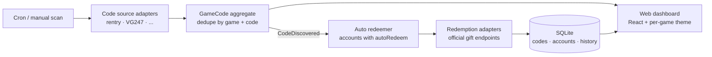

<div align="center">


**Gacha game gift codes — found, tracked and redeemed on their own.**

[](https://nodejs.org)
[](https://nestjs.com)
[](https://react.dev)
[](https://sqlite.org)
[](https://vitest.dev)
[](LICENSE)

</div>

---

HakkuAuto scrapes gift-code sources for the gacha games you play, keeps them in a themed web dashboard, and redeems them automatically to your accounts — full auto, with per-account toggles. Built on a strict DDD + hexagonal architecture so adding a new game never means touching the core.



## Features

- **Scrape & dedupe** — code sources are plain adapters; codes normalize, dedupe and expire in the domain layer.
- **Full-auto redemption** — new codes go straight to every account with `autoRedeem` enabled, with a courtesy delay between requests to the official sites.
- **Per-account control** — enable/disable auto-redeem per account, redeem manually anytime, inspect the full history per game.
- **Honest failures** — provider errors map to real statuses (`ALREADY_USED`, `EXPIRED`, `INVALID_CODE`, ...). Terminal failures (`EXPIRED`, `INVALID_CODE`) are never retried per account; transient ones (rate-limit, network errors) retry on the next scan. When a flow requires a captcha, the code is flagged `NEEDS_MANUAL` with a deep link to the official site — HakkuAuto never tries to bypass protections.
- **Themed per game** — each game plugin ships its accent colors and official art URLs; the generic UI dresses itself. Click anywhere on a game page for game-themed particle bursts.
- **Bilingual UI** — Spanish/English toggle, persisted; new languages are one flat JSON file each.
- **One deploy** — single NestJS app serves both the API and the built React bundle; one container, one SQLite file.

## Supported games

| Game | Code source | Redemption site |
| --- | --- | --- |
| Blue Archive | [rentry.org/CouponBA](https://rentry.org/CouponBA) | [mcoupon.nexon.com/bluearchive](https://mcoupon.nexon.com/bluearchive) |
| Stella Sora | VG247 listing | [stellasora.global/gift](https://stellasora.global/gift) |
| Brown Dust 2 | [browndust2-db.souseha.com](https://browndust2-db.souseha.com/en/) | [redeem.bd2.pmang.cloud](https://redeem.bd2.pmang.cloud/bd2/index.html) |

Reverse-engineered redemption endpoints are documented in [`docs/redemption/`](docs/redemption/).

## Quickstart

Docker (recommended):

```bash
cp .env.example .env   # optional; defaults work out of the box (set API_TOKEN here if your LAN is shared)
docker compose up --build
```

Open `http://localhost:3000`, add an account per game, flip auto-redeem on. A fresh install starts with an empty database — your credentials never leave the container volume.

Local development:

```bash
npm install
npm run dev            # tsc watch + node --watch + vite dev (proxies /api)
npm test               # Vitest
```

## Configuration

| Variable | Default | Description |
| --- | --- | --- |
| `PORT` | `3000` | Port for the web UI + API |
| `DATA_DIR` | `./data` (Docker: `/data`) | Where the SQLite database lives |
| `SCAN_MINUTES` | `30` | Minutes between automatic source scans |
| `REDEEM_DELAY_MS` | `1500` | Courtesy pause between redemptions of the same game |
| `STARTUP_SCAN` | `true` | Run a scan right after boot |
| `API_TOKEN` | _(empty)_ | Shared secret for the API. When set, every /api request must send X-API-Token (the web UI asks for it once and stores it in your browser). Empty = open API, for trusted LANs. |

## Adding a game

Games are plugins. Create `src/infrastructure/games/<game-id>/` with a definition (metadata, servers, account fields, theme), a code-source adapter and a redemption adapter, then register the plugin — the domain, application layers and WebUI adapt from metadata alone. The full walkthrough lives in [AGENTS.md](AGENTS.md).

## Special thanks

- **[rm6alalauau](https://github.com/rm6alalauau)** — [The BD2 Pulse](https://thebd2pulse.com) / [BD2-Archive](https://github.com/rm6alalauau/BD2-Archive) (MIT): the public coupon endpoint and reference redemption flow behind the Brown Dust 2 adapter.
- **souseha (WangCH)** — [BD2DB](https://browndust2-db.souseha.com/en/): the Brown Dust 2 coupon list this project scans.
- **[/bag/ — Blue Archive general](https://8chan.moe/gacha/)** on 8chan.moe's /gacha/ board — maintainers of the [rentry.org/CouponBA](https://rentry.org/CouponBA) list behind the Blue Archive source.

## Architecture

Classic clean/hexagonal layering, dependencies pointing inward only:

```
src/domain/           pure TypeScript: aggregates, value objects, domain events
src/application/      use cases + driven ports (no framework imports)
src/infrastructure/   SQLite repositories, HTTP, game plugins, scheduler
src/presentation/     NestJS controllers, DTOs, error filters
webui/                React + Vite + Tailwind, themed from game metadata
```

## Disclaimer

Personal tool for personal accounts. Scraping and redemption hit the same public endpoints the official sites use — keep the delays generous, and know that game ToS may frown upon automation. If a redemption flow requires a captcha, HakkuAuto stops and hands you the code plus a link instead of trying to defeat it. HakkuAuto is designed to run on a trusted home LAN and is never meant for internet hosting; if other people use your network, set `API_TOKEN`.

## License

[MIT](LICENSE) · Logo by [Hakka](https://github.com/HakkaYoro)
